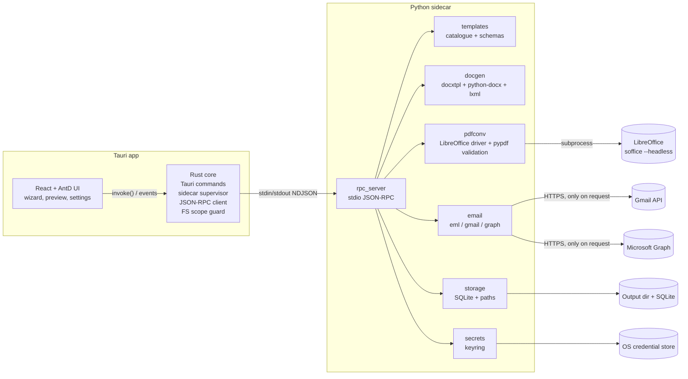
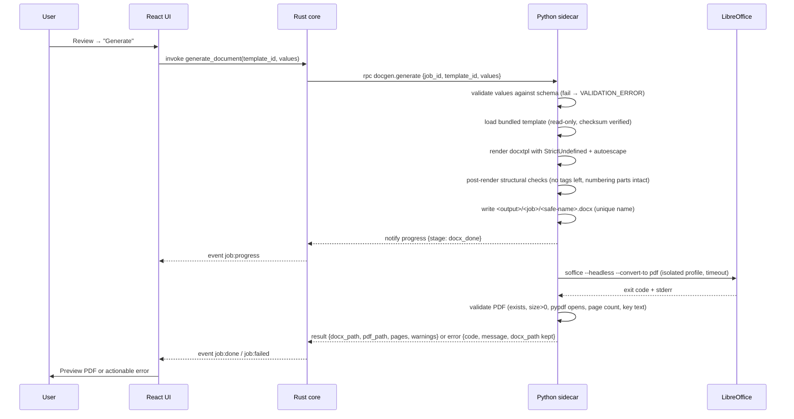

# Papyra — Architecture Proposal (Phase 0, awaiting approval)

Status: **DRAFT for approval — no application code has been written.**
Date: 2026-10-31. Author: architecture pass over the full specification.
Evidence used: the specification, a reproducible library spike in
`spikes/phase1-docx/spike_numbering.py` (results in §4.4), and the toolchain
present on this Mac (Python 3.12/3.14, Node 24; **no Rust, no LibreOffice, no Word**).

Product name: **Papyra** (approved 2026-11-03; the working folder keeps its old name).

---

## 1. Understanding of the requirements

### 1.1 What is being built
A single-user, offline-first desktop application for Windows and macOS that:

1. Lets the user pick one of a **fixed, developer-maintained** set of Word templates
   (NOC, NDA, business letter, employment documents, declarations, …).
2. Renders a **metadata-driven form** for that template, validates input, and
   lets the user review it.
3. Fills the template into a **new** `.docx` (the template is never modified),
   preserving legal formatting: multilevel legal numbering (I / A / 1 / a / i),
   headers/footers, page numbers, tables, logos, signature blocks, section breaks.
4. Converts the `.docx` to PDF **locally**, validates the PDF, and previews it.
5. Prepares an email draft with the PDF attached, in one of three ways:
   **A** offline `.eml`; **B** Gmail draft via Gmail API; **C** Outlook draft via Microsoft Graph.
   The app **never sends** email.
6. Keeps light local history/settings in SQLite; stores files on disk;
   stores OAuth tokens only in the OS credential store.

### 1.2 Functional requirements (condensed)
| ID | Requirement | Source § |
|----|-------------|----------|
| F1 | Template catalogue driven by configuration; name, description, version, input schema per template | 4, 5 |
| F2 | Users cannot upload, replace or edit templates | 4 |
| F3 | Dynamic form: text, multiline, date, number, dropdown, checkbox; required markers; defaults; validation; values preserved across steps | 5 |
| F4 | Review step before generation; correct-and-regenerate loop | 5, 8 |
| F5 | DOCX generation preserving styles, numbering, headers/footers, fields, images, tables, sections, metadata | 6 |
| F6 | Generator fails loudly on missing values, undefined placeholders, bad mappings, unexpected structure | 6 |
| F7 | Local DOCX→PDF; verify exists, non-empty, parseable, expected page count, essential text present | 7 |
| F8 | Preserve DOCX if PDF fails; actionable error; no email draft on failure | 7, 9 |
| F9 | PDF preview; open externally; save copy; detect stale PDF after external DOCX edit | 8 |
| F10 | `.eml` with To/CC/BCC/Subject/Body + PDF, RFC-compliant, Unicode-safe | 9A |
| F11 | Gmail draft via OAuth 2.0, minimal scope, confirmed success | 9B |
| F12 | Outlook draft via Microsoft Graph, minimal scope, confirmed success | 9C |
| F13 | Dashboard, template selection, form, review, generation, preview, email, settings screens | 12 |
| F14 | Local history of jobs/drafts; delete generated files and history | 13, 11 |
| F15 | Diagnostics screen: LibreOffice found/version, backend health, output dir writable | 12H |

### 1.3 Non-functional requirements
| ID | Requirement |
|----|-------------|
| N1 | **Offline**: everything except OAuth and online draft creation works with networking disabled; this is a tested acceptance criterion |
| N2 | **Fidelity**: generated PDF matches approved reference within defined tolerances per template; regression suite |
| N3 | **Security**: narrow IPC surface; no arbitrary FS access from the UI; path-traversal-safe filenames; tokens in OS keystore; no secrets in frontend; no sensitive data in logs |
| N4 | **Responsiveness**: UI never blocks; progress for long operations; duplicate generation prevented |
| N5 | **Robustness**: centralized error taxonomy; partial failures never corrupt templates or existing outputs |
| N6 | **Portability**: Windows 10/11 x64; macOS Apple Silicon (Intel TBD, see §10) |
| N7 | **Maintainability**: templates versioned; schema separate from UI; modular Python packages |
| N8 | **Licensing**: every dependency's license recorded and compatible with closed-source distribution (see §8) |

### 1.4 Explicit non-goals (v1)
Sending email; cloud storage; user-authored templates; collaborative editing;
automatic updates (optional check only); mobile/Linux builds.

---

## 2. Recommended architecture and stack

### 2.1 Decision summary
| Concern | Decision | Why (short) |
|---------|----------|-------------|
| Shell | **Tauri 2** + React 18 + TypeScript + Ant Design 5 + Vite | As specified; small binaries; strong IPC scoping |
| Backend | **Python 3.12** packaged with **PyInstaller** as a Tauri **sidecar** | Spec requires Python; sidecar avoids a local HTTP server |
| IPC | **JSON-RPC 2.0 over the sidecar's stdin/stdout**, spoken by **Rust**, not by the WebView | Simplest secure channel: no port, no auth token, no CORS, process-bound lifetime |
| FastAPI | **Not used** | An HTTP server adds port/lifecycle/local-attack surface for no benefit here |
| DOCX engine | **docxtpl (Jinja2) on top of python-docx, plus targeted lxml helpers** | Validated in spike (§4.4); numbering preserved; fails loudly |
| PDF | **LibreOffice headless** via an abstract converter; detected, not bundled, in v1 | MPL-licensed, cross-platform; bundling deferred (§5) |
| PDF validation | **pypdf** (BSD) | Page count + text extraction; avoids AGPL PyMuPDF |
| PDF preview | **pdf.js** (Apache-2.0) inside the WebView, bytes served by a scoped Tauri command | Identical rendering on both OSes; no asset-protocol differences |
| Storage | SQLite via stdlib `sqlite3`; files under an app-managed output dir | Single user, no ORM needed |
| Secrets | **keyring** → macOS Keychain / Windows Credential Manager (with chunking, §7) | Spec N3 |
| Email | stdlib `email` for `.eml`; `google-api-python-client` + `google-auth-oauthlib`; `msal` + `requests` for Graph | Mature, Apache/MIT licensed |
| Tests | pytest; Vitest; Playwright via Tauri WebDriver (desktop E2E) | As specified |

### 2.2 Component diagram


### 2.3 Trust boundaries
* **WebView → Rust**: only named Tauri commands with typed payloads. No `fs`, `shell`
  or `http` plugin exposure to the frontend. CSP forbids remote content; navigation
  is disabled. The UI never sees absolute paths it can edit; it refers to jobs by ID.
* **Rust → Python**: Rust owns the sidecar process; the UI cannot spawn or talk to it.
  Every RPC method has a Pydantic request/response model. Payload size limit and
  per-call timeouts are enforced in Rust.
* **Python → filesystem**: all writes go through `storage.paths`, which only resolves
  inside the configured output dir and the app data dir and rejects traversal,
  reserved names and unsafe characters.
* **Python → network**: only `email.gmail` and `email.graph` import HTTP clients;
  the rest of the package has no network code (enforced by an import-linter rule and
  by the offline acceptance test).

### 2.4 Document-generation sequence


### 2.5 Email-draft sequence (online provider; offline is the same up to step 3)
```mermaid
sequenceDiagram
  participant U as User
  participant UI as React UI
  participant R as Rust core
  participant P as Python sidecar
  participant K as OS keystore
  participant G as Gmail / Graph
  U->>UI: Fill recipients, subject, body; pick provider; "Create draft"
  UI->>R: invoke create_draft(job_id, mode, message)
  R->>P: rpc email.create_draft
  P->>P: re-validate PDF for job (exists, hash matches job record → not stale)
  P->>P: validate addresses, size limits (25 MB Gmail / 150 MB Graph), build MIME
  alt offline (.eml)
    P->>P: write .eml (X-Unsent: 1) to output dir
  else online
    P->>K: load token cache
    alt no / expired / revoked token
      P->>G: OAuth 2.0 auth-code + PKCE via loopback (system browser)
      G-->>P: tokens → K
    end
    P->>G: drafts.create / POST /me/messages (+attachments)
    G-->>P: draft id (success only if provider returns it)
  end
  P-->>R: {draft_ref, provider, status}
  R-->>UI: result
  UI->>U: "Draft saved in <provider>" + open link / open .eml
```

### 2.6 Proposed directory structure
```
doc-master/
├── apps/desktop/                # Tauri 2 + React
│   ├── src/                     # React: features/{dashboard,templates,form,review,generate,preview,email,settings}
│   │   ├── api/                 # typed wrappers around invoke()/events (generated from RPC schema)
│   │   └── components/
│   ├── src-tauri/
│   │   ├── src/{main.rs,sidecar.rs,rpc.rs,commands/*.rs,scope.rs}
│   │   ├── binaries/            # built Python sidecar (per target triple)
│   │   ├── capabilities/        # Tauri 2 permission sets (minimal)
│   │   └── tauri.conf.json
│   └── tests/                   # Vitest + Playwright/WebDriver
├── backend/                     # Python package `docmaster`
│   ├── docmaster/
│   │   ├── rpc/                 # stdio JSON-RPC server, method registry, progress notifications
│   │   ├── templates/           # catalogue loader, schema models, bundled template registry
│   │   ├── docgen/              # renderer, template linter, ooxml helpers (numbering, fields, sectPr), postchecks
│   │   ├── pdfconv/             # converter interface, libreoffice.py, validate.py, locator.py
│   │   ├── email/               # mime.py, eml.py, gmail.py, graph.py, oauth.py
│   │   ├── storage/             # db.py (SQLite + migrations), paths.py, history.py, settings.py
│   │   ├── secrets/             # keyring adapter with chunking
│   │   ├── errors.py            # error taxonomy (codes → user messages)
│   │   └── logging_.py          # structured, redacting
│   ├── tests/{unit,integration,fidelity}/
│   ├── pyinstaller/             # spec files per OS
│   └── pyproject.toml
├── templates/                   # bundled .docx templates + manifest.yaml (versioned)
│   ├── manifest.yaml
│   ├── noc/v1/{template.docx,schema.yaml,reference.pdf}
│   └── nda/v1/...
├── tools/                       # template linter CLI, fidelity-compare CLI, build scripts
├── docs/
└── .github/workflows/           # macOS + Windows build/test matrix
```

---

## 3. python-docx vs docxtpl vs direct OOXML

| Criterion | python-docx | docxtpl | Direct OOXML (lxml) |
|-----------|-------------|---------|---------------------|
| License | MIT | **LGPL-2.1** (see §8) | BSD (lxml) |
| Model | Object model over the OOXML package; round-trips untouched parts byte-for-byte | Jinja2 templating of each XML part, then python-docx underneath | Full control, no safety net |
| Placeholder split across runs (Word does this constantly) | Not handled; you must merge runs yourself | **Handled** — tags are normalised before rendering (verified) | Must implement |
| Repeating content (variable clause count, table rows) | Manual deep-copy of `w:p`/`w:tr` | ``, `` — clones keep `w:numPr` (verified) | Manual |
| Headers / footers | Supported | Rendered as well (verified) | Yes |
| Native numbering definitions (`numbering.xml`) | Exposed as raw element only; **no API** | None (preserves what is there) | **Required** for creating/restarting lists |
| Fields (PAGE, NUMPAGES, DATE) | No API; preserved | Preserved (verified) | Required to insert |
| Images | Add inline pictures; preserves existing | `InlineImage` for dynamic logos/signatures | Yes |
| Section properties, page setup | Partial API; preserved | Preserved | Full |
| Missing / undefined placeholders | n/a | `StrictUndefined` raises; `get_undeclared_template_variables()` lists tags (verified) | n/a |
| XML-injection safety | n/a | `autoescape=True` escapes `& < >` (verified) | Your responsibility |
| Risk | Writing our own run-merging engine (~weeks, subtle) | It works on the serialised XML of each part. This is *controlled* templating with tag normalisation and escaping, not naive string replacement, but output must be re-validated | Easy to produce documents Word repairs or rejects |

**Recommendation — a three-layer engine:**
1. **docxtpl** does substitution and repetition.
2. **python-docx** does object-level operations (core properties, opening/validating output, image insertion).
3. **A small, tested `ooxml` helper module (lxml)** does the few things neither supports:
   numbering restarts (`w:num` + `w:lvlOverride/w:startOverride`), field insertion/`w:dirty`,
   `w:sectPr` tweaks, content-control (`w:sdt`) handling if templates use them.

Guardrails that make this acceptable for legal documents:
* A **template linter** (CI + developer CLI) that opens every bundled template and
  rejects: tags split across runs in ways docxtpl can't normalise, tags inside
  tracked changes, smart-quote-corrupted `{{`, unknown variables not in the schema,
  schema fields unused by the template.
* **Post-render checks**: no `{{`/`{%` left in any part; the set of
  `w:abstractNum`/`w:num` ids is unchanged; relationship and content-type parts
  unchanged except for intended additions; output reopens in python-docx.
* **RichText only via `{{r var }}`**; plain strings get newline → `w:br` (verified).

If LGPL is unacceptable to you (§8), the fallback is to implement run-merging
placeholder substitution on python-docx ourselves; estimate +2 weeks and higher risk.

---

## 4. Feasibility: numbering, formatting, headers/footers, page layout

### 4.1 The key insight
Because templates are **developer-authored and bundled**, the generator does not
have to *create* legal numbering, styles, headers, footers or page setup at run
time. It has to **preserve** them. python-docx round-trips every part it does not
touch, and docxtpl only rewrites text inside existing paragraphs. So fidelity is
chiefly a **template-authoring** discipline plus a **rendering-engine** question
(Word vs LibreOffice), not a Python problem.

### 4.2 Per-feature assessment
| Feature | Preserve in template? | Dynamic need | Assessment |
|---------|----------------------|--------------|------------|
| Multilevel legal numbering I/A/1/a/i | Yes (native `w:numPr` + `numbering.xml`) | Variable clause counts via ``; cloned paragraphs keep `numPr` → continuation is native | **Feasible (verified)** |
| Restart numbering per generated section | Template-level | Needs new `w:num` with `lvlOverride` | Feasible via ooxml helper; only if a template needs it |
| Fonts/sizes/weights, paragraph & line spacing, indents | Yes (styles + direct formatting) | Values inherit the placeholder run's formatting | Feasible; linter checks placeholder runs carry intended formatting |
| Margins, orientation, section breaks | `w:sectPr` preserved | None | Feasible |
| Headers/footers, repeating headers, page numbers | Preserved; PAGE/NUMPAGES fields preserved | Placeholders in headers render | **Feasible (verified)**; LibreOffice computes fields on export |
| Tables, borders, multi-page tables, repeating header rows | Preserved | `` for dynamic rows | Feasible; header-row repeat is a table property |
| Logos / signature images | Embedded in template | Dynamic signature image via `InlineImage` | Feasible |
| Digital-signature placeholders | Visual block / `w:sdt` | None in v1 | Feasible as visual placeholder; real digital signing is out of scope |
| Page breaks | Preserved | Conditional via `` around a paragraph with a break | Feasible |
| Document metadata | Set via `core_properties` | Title/author/created | Feasible |
| TOC / cross-references | Fields need updating | — | **Avoid in templates**; headless LibreOffice does not refresh TOC reliably |
| Tracked changes / comments in template | — | — | Linter rejects; templates must be clean |

### 4.3 Known Word ↔ LibreOffice rendering differences to budget for
* Tab stop after the list number and hanging indents can differ slightly → use explicit
  `w:ind` on each level and a tab stop matching the hanging indent (LibreOffice honours these).
* `w:isLgl` (legal numbering style forcing arabic for upper levels) is supported but
  verify per template.
* Font substitution: Times New Roman exists on Windows and macOS; LibreOffice falls back to
  Liberation Serif (metric-compatible) when missing, so pagination holds.
* Table autofit and cell margins; keep fixed column widths in templates.
* Widow/orphan and "keep with next" behave slightly differently → avoid pagination-sensitive
  layouts near page ends; put page breaks explicitly where legally required.
* Headless LibreOffice does not update `DATE`/`TOC` fields → the app writes dates as text.

### 4.4 Spike evidence (this machine, 2026-10-31, docxtpl 0.20.2 / python-docx 1.2.0)
`spikes/phase1-docx/spike_numbering.py` builds a template with a 5-level legal
list (upperRoman, upperLetter, decimal, lowerLetter, lowerRoman), placeholders in
body/table/header, a `` loop around a numbered paragraph and PAGE/NUMPAGES
fields, then renders it. Results, all PASS:

* the 5-level `abstractNum` survives untouched in `numbering.xml`
* the loop produced 3 numbered clauses that keep `ilvl=1 numId=10` (native continuation)
* header placeholder rendered; footer fields kept; table cell rendered; core properties kept
* `& < >` escaped; Unicode (`Zoë Müller-Łukasz`) intact; no Jinja tags left
* a placeholder split across two differently-formatted runs rendered correctly
* a missing value raised `UndefinedError` instead of producing a blank
* `\n` in a plain value became `<w:br/>`; `RichText` requires the `{{r }}` tag form

**Not yet verified** (no LibreOffice/Word here): PDF rendering fidelity. That is
the first Phase-1 task and needs LibreOffice installed on this Mac and a Windows machine.

---

## 5. Offline PDF-conversion strategy

### 5.1 Engine
**LibreOffice headless** is the only mature, locally runnable, cross-platform
DOCX→PDF renderer with an acceptable license (MPL-2.0). Pure-Python converters
re-layout the document and are unfit for legal fidelity.

Invocation (per job, isolated profile so concurrent runs cannot deadlock on the
shared user-profile lock):
```
soffice --headless --norestore --nologo
        -env:UserInstallation=file:///<tmp>/lo-profile-<job>
        --convert-to pdf:writer_pdf_Export --outdir <tmp-out> <job>.docx
```
Wrapped by a `PdfConverter` interface:
* locate binary (Settings override → platform defaults → PATH); report version in Diagnostics
* per-job temp dir, unique names, hard timeout (default 120 s, configurable), kill process tree
* capture stdout/stderr into the job log (never into the UI verbatim)
* **serialise** conversions with a process-wide lock in v1 (one at a time is plenty for a
  single user and removes a class of LibreOffice bugs)
* validate with pypdf: exists, size > 0, opens, `len(pages) == expected ± tolerance`,
  essential text present (e.g. reference number, signatory)
* move PDF next to the DOCX only after validation; on failure keep the DOCX and
  return `PDF_CONVERSION_FAILED` with the LibreOffice stderr summary.

Default locations: Windows `C:\Program Files\LibreOffice\program\soffice.exe`;
macOS `/Applications/LibreOffice.app/Contents/MacOS/soffice`.

### 5.2 Distribution decision (v1): **detect, don't bundle**
| Option | Pros | Cons |
|--------|------|------|
| Bundle LibreOffice inside the installer | Zero-setup; pinned version → stable rendering | +350–450 MB per installer; macOS notarisation requires re-signing hundreds of nested binaries; LibreOffice updates become our releases |
| **Require installed LibreOffice (recommended v1)** | Small installer; user/IT manages LO; simpler signing | First-run friction; rendering may vary across LO versions → Diagnostics shows version and warns outside the tested range |
| Microsoft Word automation (Windows COM; macOS AppleScript) as an **optional second engine** | Best fidelity when Word is present (templates are authored in Word) | Requires Word; licensing of Word is the user's; slower startup |

Phase 1 produces fidelity numbers that may justify bundling later; the converter
interface keeps that door open without redesign.

### 5.3 PDF preview and staleness
pdf.js renders the PDF inside the WebView; bytes are delivered by a Tauri command
that only accepts a job id. Each job record stores the SHA-256 of the DOCX and PDF.
Before preview or email, the backend re-hashes the DOCX; if it changed (user edited
it externally) the PDF is marked **stale** and the UI requires "Regenerate PDF"
before continuing. No outdated PDF is ever attached.

---

## 6. Python ↔ Tauri integration strategy

### 6.1 Options considered
| Option | Verdict |
|--------|---------|
| **Sidecar + JSON-RPC over stdio, driven from Rust** | **Chosen.** No port, no auth token, lifetime bound to the app, nothing for another local process to connect to. Rust `tauri-plugin-shell` spawns `externalBin` and streams stdout lines. |
| FastAPI on loopback with random port + bearer token | Works, but adds a server lifecycle, port races, token plumbing, CORS, and an attack surface other local processes can probe. Not justified by any requirement (no second client, no streaming large payloads). |
| Embedding Python in Rust (PyO3) | Cross-platform packaging pain; crashes take down the UI. Rejected. |
| Unix socket / named pipe | Equivalent to stdio with more platform-specific code. Rejected. |

### 6.2 Protocol
* NDJSON frames, JSON-RPC 2.0: `request`, `response`, and server→client `notification`
  (`job.progress`, `log`). One request in flight per id; concurrency handled in Python
  with a thread pool for blocking work (LibreOffice subprocess, HTTP).
* Methods are a **closed list** with Pydantic models; the Rust side maps each to one
  Tauri command, so the frontend contract is typed end-to-end (TypeScript types
  generated from the Pydantic JSON schema in CI).
* Health: Rust sends `system.ping` on start with a 10 s deadline; restarts the sidecar on
  crash (max 3 times) and surfaces `BACKEND_UNAVAILABLE` otherwise.
* Shutdown: Rust sends `system.shutdown`, waits 5 s, then kills; Python marks in-flight
  jobs `INTERRUPTED` in SQLite so the dashboard can show them as recoverable.

### 6.3 Packaging the sidecar
* **PyInstaller one-dir** per target, bundled as a Tauri resource and spawned via
  `shell().command()`. *(Revised after Phase 1: one-file measured 3.5 s cold start vs 98 ms for
  one-dir on macOS; see `docs/phase1-log.md`.)*
* Known costs and mitigations: macOS scans a new unsigned binary for ~20 s on first launch
  (signing/notarisation required for release); antivirus false positives on Windows
  (**code-signing** the exe is the real fix); macOS **hardened runtime** needs the
  entitlements `com.apple.security.cs.allow-unsigned-executable-memory` and
  `com.apple.security.cs.disable-library-validation` for the Python runtime; the
  sidecar must be signed before Tauri bundles it, and the whole app notarised.
* Nuitka is the fallback if PyInstaller startup or AV behaviour is unacceptable.

---

## 7. Email: offline `.eml` vs Gmail vs Outlook

> **Revised 2026-11-03**: the user's mailbox is Porkbun hosted email (standard IMAP). Phase 4 was
> built as `.eml` + **IMAP draft append** (any provider). Gmail/Graph columns below are kept for
> reference and are not implemented.

| Aspect | A. Offline `.eml` | B. Gmail API draft | C. Microsoft Graph draft |
|--------|-------------------|--------------------|--------------------------|
| Network | None | OAuth + API call | OAuth + API call |
| Library | stdlib `email.message.EmailMessage`, `policy.SMTP`; RFC 2047 headers, RFC 2231 filenames, base64 attachment | `google-auth-oauthlib` (installed-app flow, PKCE, loopback), `googleapiclient` `users.drafts.create` with base64url RFC 822 | `msal` PublicClientApplication (auth-code + PKCE, loopback) → `POST /me/messages` then attachments |
| Minimum scope | — | `gmail.compose` — this is a **restricted** scope and also permits sending; the app never calls `send` | `Mail.ReadWrite` — no drafts-only scope exists; `offline_access` for refresh |
| Attachment limit | Practical only (client-dependent) | 25 MB message; use media upload above 5 MB | 3 MB inline; 3–150 MB via upload session |
| Result certainty | File written; **import behaviour varies**: Outlook desktop opens `.eml` with `X-Unsent: 1` as an editable unsent message; Apple Mail/Thunderbird open it as a received message and will not save it to Drafts | Draft id returned → certain | Message id returned → certain |
| Token storage | n/a | keyring (Keychain / Credential Manager) | MSAL `SerializableTokenCache` → keyring |
| Non-technical prerequisite | None | Google Cloud project; **OAuth verification for a restricted scope** (until verified: "unverified app" warning, 100-user cap). Local-only data use may exempt from the paid security assessment but still needs review | Entra app registration; corporate tenants may require admin consent; decide Work/School vs personal Outlook.com audiences |
| Offline-first fit | Perfect | Only when user opts in | Only when user opts in |

Shared rules: addresses validated with `email-validator`; one MIME builder feeds all
three paths (so `.eml` and the Gmail raw message are byte-identical); success is
reported **only** when the provider returns a draft id; refresh/revocation errors map
to `AUTH_REQUIRED` with a "Reconnect account" action; nothing in logs beyond provider
error codes.

Windows Credential Manager caps a credential blob at 2560 bytes; MSAL and Google token
caches can exceed that, so the keyring adapter **chunks** values across multiple entries.

Optional later addition: on Windows with Outlook installed, a true offline Drafts
entry is possible through Outlook COM (`MailItem.Save`). Noted, not in v1 scope.

---

## 8. Dependency and licensing assessment

| Component | License | Note |
|-----------|---------|------|
| Tauri 2, tauri-plugin-shell | MIT / Apache-2.0 | |
| React, Ant Design, Vite, TypeScript | MIT / Apache-2.0 | |
| pdf.js (`pdfjs-dist`) | Apache-2.0 | bundled in frontend |
| python-docx 1.2 | MIT | |
| **docxtpl 0.20** | **LGPL-2.1** | OK for a proprietary app if users can replace the library. With PyInstaller we can ship docxtpl as a separate, replaceable `.pyc`/source directory outside the one-file archive, or use one-dir mode. Needs your sign-off; fallback in §3 |
| Jinja2, lxml, pypdf, pydantic, email-validator, keyring, requests | BSD / MIT / Unlicense | |
| msal | MIT | |
| google-auth, google-auth-oauthlib, google-api-python-client | Apache-2.0 | |
| PyInstaller | GPL-2.0 **with bootloader exception** | produced executables are not GPL |
| LibreOffice | MPL-2.0 | not bundled in v1; if bundled later, ship unmodified with notices |
| **PyMuPDF** | AGPL | **excluded** |
| Poppler (pdf2image) | GPL | **dev/test only**, for rendering pages in fidelity tests; never shipped |

---

## 9. Risk register (highest first)

| # | Risk | Likelihood | Impact | Mitigation / owner of decision |
|---|------|-----------|--------|--------------------------------|
| R1 | LibreOffice renders legal numbering/tables differently from Word on real templates | Medium | High | Phase-1 fidelity harness on both OSes; template authoring rules (§4.3); optional Word engine; approved reference PDFs per template |
| R2 | Placeholders broken by Word (split runs, smart quotes, proofing marks) | High | Medium | docxtpl normalisation (verified) + template linter in CI + authoring guide |
| R3 | macOS signing/notarisation of PyInstaller sidecar | Medium | High (blocks release) | Entitlements known (§6.3); prove on CI in Phase 1; Apple Developer ID needed from you |
| R4 | Google restricted-scope verification delays Gmail feature | High | Medium | Start verification early; ship `.eml` + Outlook first; Gmail behind "test users" until verified |
| R5 | LibreOffice absent/old on user machines | High | Medium | Diagnostics + guided install + path override; tested-version range; revisit bundling after Phase 1 |
| R6 | Windows AV flags PyInstaller one-file exe | Medium | Medium | Code-sign; one-dir fallback; Nuitka fallback |
| R7 | Windows Credential Manager 2560-byte limit breaks token caches | High (if ignored) | Medium | Chunked keyring adapter + tests |
| R8 | `.eml` does not land in Drafts for Apple Mail/Thunderbird users | Certain | Low | Honest UI copy; `X-Unsent` for Outlook; Outlook COM option later |
| R9 | docxtpl LGPL conflicts with your distribution policy | Unknown | Medium | Decision needed (§10); fallback engine estimated |
| R10 | Intel Mac support doubles macOS build matrix | Unknown | Medium | Decision needed; universal binary possible but PyInstaller needs per-arch builds |
| R11 | Corporate Entra tenants block user consent for `Mail.ReadWrite` | Medium | Medium | Document admin-consent flow; single-tenant registration if this is for one organisation |
| R12 | Headless LibreOffice hangs or leaves lock files | Medium | Medium | Isolated profile per job, timeout, process-tree kill, serialised conversions |
| R13 | Fonts missing on user machine change pagination | Low (TNR) | Medium | Font check in Diagnostics; metric-compatible fallbacks; page-count tolerance per template |
| R14 | Sidecar stdio protocol stalls on large payloads | Low | Medium | File paths/job ids instead of bytes over RPC; PDF bytes read by Rust directly |
| R15 | No Windows machine available to the project | Unknown | High | GitHub Actions `windows-latest` runner for build + headless tests; a real Windows box still needed for manual fidelity review |

---

## 10. Phased implementation plan

| Phase | Scope | Exit criterion | Est. |
|-------|-------|----------------|------|
| **1. Feasibility** ✅ macOS (Windows pending) | Install LibreOffice locally; real NOC + NDA templates (or representative stand-ins) through docxtpl → PDF on macOS and on Windows CI; fidelity harness (page count, text, pixel diff vs reference); Rust↔Python stdio PoC; PyInstaller sidecar built and signed in CI for both OSes | Correct DOCX **and** PDF from a predefined legal template on both platforms; sidecar launches from a Tauri shell on both | 2 weeks |
| **2. Desktop foundation** ✅ 2026-11-03 | Tauri 2 + React + AntD scaffold; sidecar supervisor; typed RPC contract + codegen; template catalogue + manifest; metadata-driven form renderer with validation; review screen; settings/diagnostics skeleton | Pick template → fill form → review, offline, with backend health shown | 2 weeks |
| **3. Document generation** ✅ 2026-11-03 | docgen engine + ooxml helpers + linter; PDF converter + validation; generation screen with progress; pdf.js preview; staleness detection; error taxonomy | End-to-end DOCX + PDF for all bundled templates, with regression suite green | 3 weeks |
| **4. Email** ✅ 2026-11-03 (.eml + IMAP; Gmail/Graph dropped, see phase1-log) | MIME builder; `.eml`; Gmail OAuth + draft; Graph OAuth + draft; keyring with chunking; email screen with confirmation | Drafts created and confirmed in both providers; `.eml` opens in Outlook/Mail/Thunderbird as documented | 3 weeks |
| **5. Persistence & privacy** ✅ 2026-11-03 | SQLite schema + migrations; history; delete data; temp cleanup; log redaction; security review of IPC scope | Offline acceptance test passes with networking disabled; security checklist signed off | 1.5 weeks |
| **6. Testing & distribution** ✅ macOS 2026-11-06 (Windows via CI pending) | Full Playwright suite; Windows installer (NSIS/MSI) + macOS DMG, signed and notarised; docs; troubleshooting guide; license notices | Installable, signed builds on both OSes pass the acceptance suite | 2 weeks |

Each milestone ships runnable code, tests, and updated docs, and is demonstrated
before the next starts. Total ≈ 13–14 weeks of focused work; Phases 2 and the
non-document parts of 4 can overlap once Phase 1 is accepted.

---

## 11. Minimum information needed before implementation

Decisions I need from you (everything else I will decide and document):

1. **Templates**: can you provide the actual NOC and NDA `.docx` files (and any others for v1)? If not yet, I will author representative stand-ins and swap them later.
2. **docxtpl's LGPL-2.1 license**: acceptable for your distribution, or should I build the MIT-only fallback engine (+2 weeks)?
3. **macOS targets**: Apple Silicon only, or Intel too? (affects build matrix and testing)
4. **Windows access**: do you have a Windows 10/11 machine or VM for manual fidelity review? CI will cover automated tests either way.
5. **LibreOffice**: is "install LibreOffice separately, guided by the app" acceptable for v1, with bundling re-evaluated after Phase 1?
6. **Signing credentials**: do you have (or will you obtain) an Apple Developer ID and a Windows code-signing certificate? Unsigned builds work for development but not for end users.
7. **Email audience**: is this for one organisation (single Entra tenant, one Google Workspace domain) or for the public? It changes the OAuth registrations and the Google verification path.
8. **Provider accounts**: who owns the Google Cloud project and the Entra app registration — you, or should I create them under accounts you provide?
9. **Form-value retention**: should document history store the entered values (convenient for regeneration) or only metadata (default per spec)?
10. **Locale**: date format and language for generated documents (e.g. "31 October 2026" vs "31/10/2026"), and currency/number formats if any template uses them.

Assumptions I will proceed on unless you object: product name "Papyra";
Python 3.12; Tauri 2; Ant Design 5; English UI; A4 default page size; output
directory defaults to `~/Documents/Papyra`; one conversion at a time.
